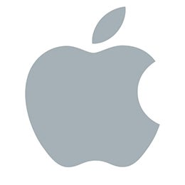

 <a href="https://jinawinwin.github.io/SEC_Apple/"><strong>🔗 대시보드 바로가기</strong></a>

# Apple Inc. SEC 재무 분석

Apple의 SEC 공시를 이용해 재무 성과를 확인하는 대시보드입니다.

- 상단: 매출·순이익 추이, 현금흐름 차트와 주요 KPI
- 하단: Annual, Half-year, Quarterly 수치 테이블
- 우측 플로팅 메뉴: 대시보드 PDF 저장, 기간별 Excel 다운로드
- 분석: 전년 대비 매출·순이익 성장률, 매출총이익률·영업이익률·순이익률, 잉여현금흐름률, 현금전환율, 자본적지출률, 부채/자산 및 현금/부채 비율
- Global Peer Firms: 삼성전자, 샤오미, Alphabet, Microsoft, Sony

## 자동 업데이트

GitHub Actions가 매월 1일 00:00 UTC에 SEC Company Facts API에서 데이터를 다시 가져옵니다. 공시가 새로 제출된 뒤 수치가 반영됩니다. 첫 수집 전 [Actions Secrets 설정](https://github.com/jinawinwin/SEC_Apple/settings/secrets/actions)에서 **New repository secret**을 눌러 이름 `SEC_CONTACT_EMAIL`, 값은 모니터링 가능한 연락 이메일로 추가해야 합니다. 이메일은 저장소 코드에 공개되지 않습니다. 설정 후 Actions → Update Apple SEC dashboard → Run workflow로 수동 수집할 수 있습니다. 코드 변경 시에는 수집하지 않고 Pages만 배포합니다.

**현재 상태:** `data/financials.json`의 연간·반기·분기 배열이 비어 있어 실제 분석값은 아직 표시되지 않습니다. `SEC_CONTACT_EMAIL` 설정 후 수집 작업이 성공하면 대시보드가 저장된 데이터로 자동 계산합니다.

출처는 [SEC Company Facts API](https://www.sec.gov/edgar/sec-api-documentation), Apple CIK 0000320193입니다. 금액은 USD millions, EPS는 USD이며 SEC XBRL GAAP 태그를 사용합니다. 반기는 6개월 누적 공시, 분기는 SEC 분기 공시 기준입니다.

## Global Peer Firms

| 기업 | 종목 코드 | 주요 비교 영역 | 선정 근거 | 자료 |
|---|---|---|---|---|
| 삼성전자 | 005930.KS | 스마트폰·태블릿·웨어러블 | Galaxy 기기 생태계가 iPhone·iPad·Apple Watch와 경쟁합니다. 반도체·가전 사업도 있어 전사 실적 비교에는 주의가 필요합니다. | [사업보고서](https://www.samsung.com/sec/ir/reports-disclosures/public-disclosure/3755/) |
| 샤오미 | 1810.HK | 스마트폰·태블릿·웨어러블·IoT | 스마트폰과 연결 기기 생태계가 Apple의 하드웨어 사업과 겹칩니다. 전기차 사업의 비중은 별도로 고려해야 합니다. | [투자자 자료](https://ir.mi.com/corporate-information/company-profile) |
| Alphabet | GOOGL / GOOG | 모바일 OS·앱 플랫폼·디지털 서비스·기기 | Android·Google Play·Pixel과 구독 서비스가 iOS·App Store·iPhone 및 Apple 서비스와 겹칩니다. 광고·클라우드 사업 비중이 큽니다. | [2025 Form 10-K](https://www.sec.gov/Archives/edgar/data/1652044/000165204426000018/goog-20251231.htm) |
| Microsoft | MSFT | PC·운영체제·생산성 서비스 | Surface·Windows·Microsoft 365가 Mac·macOS 및 Apple의 기기·서비스 생태계와 일부 겹칩니다. 기업용 클라우드 비중이 큽니다. | [2025 Annual Report](https://www.microsoft.com/investor/reports/ar25/index.html) |
| Sony Group | 6758.T | 소비자 기기·콘텐츠 서비스 | 오디오·카메라·게임·영상 콘텐츠에서 Apple의 기기와 콘텐츠 서비스 사업을 부분적으로 비교할 수 있습니다. | [기업 개요](https://www.sony.com/en/SonyInfo/CorporateInfo/) |

이 목록은 **사업 영역별 비교 대상**입니다. 모든 사업과 회계 기준이 Apple과 일치한다는 의미가 아니며, 현재 대시보드의 재무 수치는 Apple 공시만 포함합니다.
